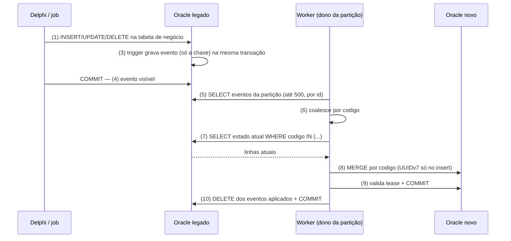

# Desenho da solução — replicação BDAD → Oracle novo

**Status:** descreve o que o módulo `worker/` implementa hoje. Decisões e justificativas completas estão em [`adr-replocacao.md`](adr-replocacao.md) (proposto, pendente de medições válidas). Os números de desempenho citados aqui são os da PoC e estão qualificados em `resultados/relatorio.md`.

A numeração (1)–(10) é a mesma do diagrama Excalidraw que acompanha este documento.

## 1. Visão em uma frase

Um trigger no Oracle legado anota **só a chave** de cada linha alterada numa tabela de eventos. Um worker Java lê esses eventos, **busca o estado atual** da linha no legado e grava no Oracle novo com um `MERGE` idempotente. Só depois de confirmar no destino o worker apaga os eventos no legado.

Não há fila externa, Kafka nem CDC de log. O evento é um aviso ("a linha X mudou"); o dado vem sempre da leitura do estado atual, por isso a réplica se corrige sozinha no próximo evento.

## 2. Componentes

| Componente | Onde | Papel |
|---|---|---|
| Tabelas de negócio | Legado | `TITULAR`, `OBRA_MUSICAL`, `FONOGRAMA` (as mesmas tabelas que a aplicação Delphi já usa) |
| Trigger de captura | Legado | `AFTER INSERT/UPDATE/DELETE ... FOR EACH ROW`; grava um evento na mesma transação |
| `evento_replicacao` | Legado | Outbox: `id`, `tabela`, `codigo`, `op` (I/U/D), `particao`, `criado_em`. Índice `(tabela, particao, id)` |
| Worker | Java (módulo `worker/`) | Lê o outbox, busca estado, aplica no destino, apaga o evento |
| Tabelas réplica | Novo | Cópia as-is com `id` UUIDv7, `codigo` único, `origem_updated_at`, `replicado_em` |
| `lease_particao`, `worker_heartbeat` | Novo | Quem é dono de cada partição e quais réplicas estão vivas |
| Reconciliação | Fora do ciclo (hoje no módulo `poc/`) | Detecta o que o trigger deixou passar e reinsere o `codigo` no outbox |

## 3. Estímulo inicial

O ponto de partida é **uma escrita de negócio no legado**: a aplicação Delphi (ou um job em massa) faz `INSERT`, `UPDATE` ou `DELETE` em uma das tabelas replicadas. Nada no legado muda além do trigger; a aplicação não sabe da replicação.

O evento só passa a existir quando a transação do legado dá **COMMIT**. Antes disso nem a linha nem o evento são visíveis para o worker. Consequência: transação longa no Delphi aparece como lag, mas não perde evento.

## 4. Caminho do dado até o destino

### Dentro do legado (passos 1 a 4)

1. **Estímulo.** A aplicação grava na tabela de negócio.
2. **Linha gravada.** A tabela de negócio recebe a mudança (o `updated_at` é da própria linha).
3. **Trigger de captura.** Na mesma transação, insere em `evento_replicacao`: `tabela`, `codigo`, `op` e `particao = ORA_HASH(codigo, 15)`. Não serializa a linha; por isso é leve e não quebra com LOBs ou mudança de schema. O mesmo `codigo` cai sempre na mesma partição, o que preserva a ordem por chave.
4. **Evento no outbox.** Após o commit, o evento fica visível para o worker.

### Dentro do worker (passos 5 a 10)

Cada partição (`tabela`, 0..15) é processada por um loop, **um lote por vez**:

5. **Ler.** Até 500 eventos da partição, em ordem de `id`. A leitura é só consulta; nada é removido ainda.
6. **Coalesce.** Eventos do mesmo `codigo` no lote viram uma única linha a aplicar. A operação (I/U/D) deixa de importar, porque o que se aplica é o estado atual.
7. **Buscar o estado atual.** `SELECT ... WHERE codigo IN (...)` no legado, em blocos de até 1.000. Se a linha não existe mais, conta como **anomalia** (alerta), e o evento é descartado para a partição não travar.
8. **MERGE no destino.** Por `codigo`. Se a linha é nova, gera o **UUIDv7** do `id`; se já existe, o `MERGE` nunca escreve o `id`. O update só vale se `origem_updated_at` recebido for maior ou igual ao gravado (protege contra dado velho).
9. **Cerca e commit.** Imediatamente antes de comitar, o worker confirma no banco novo que ainda é dono da partição (dono, versão e prazo, medidos pelo relógio do banco) e comita na mesma chamada. Se o lease foi perdido, o lote sofre rollback e os eventos ficam para o novo dono.
10. **Ack.** Só depois do commit no destino, o worker apaga os eventos aplicados no legado e comita.

O dado chegou ao Oracle novo no passo 9. O passo 10 apenas libera o outbox.

## 5. Por que o desenho se comporta bem em falhas

| Situação | O que acontece |
|---|---|
| Worker cai entre (9) e (10) | O evento continua no outbox, é relido e o `MERGE` reaplica o mesmo estado sem efeito (idempotente). |
| Worker cai antes de (9) | Nada foi comitado no destino; o lote é refeito. |
| Dois eventos do mesmo `codigo` | Viram uma busca só; vale o estado atual, não a ordem dos eventos. |
| Evento atrasado ou fora de ordem | A guarda por `origem_updated_at` impede sobrescrever dado novo com dado velho. |
| Worker pausado com lease vencido | A cerca do passo 9 recusa o commit; o novo dono assume. |
| Linha sumiu do legado (delete físico) | Anomalia com alerta; evento descartado. Soft delete (`excluido`) é replicado como update comum. |
| Trigger desligado ou carga direct-path | Sem evento. A reconciliação detecta pela diferença de `updated_at`/hash e reinsere o `codigo` no outbox. |

## 6. Escala e alta disponibilidade

- **Partições:** 16 por tabela, fixas. Tabela nova = mais 16 partições.
- **Réplicas:** cada réplica pega uma cota das partições via `lease_particao`, com heartbeat. Se uma cai, o lease vence e outra assume (a PoC mediu 10,7–20,0 s nos testes locais; no C7 sob carga, 30 s).
- **Regra de projeto:** consistência vence disponibilidade. O failover é exceção e não é acelerado à custa de risco de dois donos.
- **Concorrência:** um loop por partição, cada um com as suas conexões.

## 7. Carga inicial e reconciliação

- **Carga inicial:** liga-se a captura **antes** e copia-se por faixa de `codigo` com o mesmo `MERGE`. Nunca truncate + insert, para não regerar UUIDs. Na PoC, 1.854.195 linhas em 109,9 s, sem divergência.
- **Reconciliação:** compara origem e réplica por delta de `updated_at` (com janela de sobreposição) e por faixa de hash. Divergência reinsere o `codigo` no outbox, e o fluxo normal corrige. Na PoC (C8): 55.629 de 55.629 chaves corrigidas.

## 8. Limites conhecidos

- A latência de ponta a ponta é definida como *commit no legado → commit no novo*. O `criado_em` do evento é o instante do insert, não do commit; transações longas aparecem como lag aparente.
- Vazão: só 500 ev/s foram demonstrados de forma válida (gerador de carga saturou acima disso). Não prometer 1.000 ou 2.000 ev/s antes de repetir no ambiente real.
- Hoje a replicação cobre `TITULAR`, `OBRA_MUSICAL` e `FONOGRAMA`. `OBRA_TITULAR` (a de maior volume) ainda não foi exercitada.
- O `Config` do worker ainda carrega padrões de laboratório (usuários/senhas de teste e opções de evidência da PoC); limpar antes de produção.

## 9. Evolução para CDC

A fronteira já separa fonte e destino: `ChangeSource` (hoje o outbox + busca de estado) e `ReplicaSink` (o `MERGE` com guarda de versão). Com Kafka/CDC de log, só a entrada muda; o destino, a idempotência e a partição por `codigo` permanecem.
